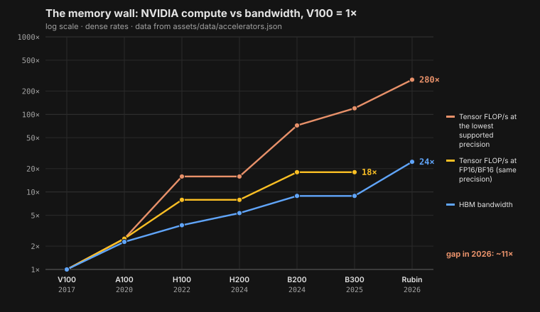

[← Back to Table of Contents](./README.md)

# Chapter 11 — The Memory Wall & Bandwidth

You have just read how memory hierarchies are structured ([Chapter 9](./09_memory_types.md)) and how the operating system manages them ([Chapter 10](./10_memory_management.md)). Now we ask the question that ties everything together for machine learning: **how fast can data actually move, and when does that speed — not compute — become the bottleneck?**

The answer lies in one of the most important phenomena in computer architecture: the **memory wall**. Compute throughput has grown faster than memory bandwidth for decades. The gap between what hardware *can calculate* and what memory *can supply* has widened into a chasm. For AI inference — especially LLM token generation — this is not background trivia. It is *the* governing constraint on your system. Every quantization decision, every batching strategy, every kernel fusion trick is, at root, a response to the memory wall.

> **The one-sentence version:** A hardware kernel is either limited by the speed at which it can do arithmetic (compute-bound) or the speed at which it can read and write memory (memory-bound), and for almost all LLM inference the answer is memory — which is why streaming fewer bytes (quantization, sparsity) speeds things up even when it adds computation.

---

## The Memory Wall

In 1995, Wulf and McKee published a short paper titled *"Hitting the Memory Wall: Implications of the Obvious."* The observation was simple but brutal: **DRAM latency was improving far more slowly than processor speed**, so programs would eventually spend most of their time waiting for memory. If you plotted the two on the same graph, the gap grew exponentially.

For accelerators the wall shows up as a ridge point (peak FLOP/s ÷ bandwidth, derived below) that keeps climbing generation after generation:

| Year | Accelerator | Dense tensor peak | Memory bandwidth | FLOP per byte (ridge) |
|:----:|-------------|:-----------------:|:----------------:|:---------------------:|
| 2017 | V100 | 125 TFLOP/s (FP16) | 0.9 TB/s (HBM2) | ~139 |
| 2020 | A100 | 312 TFLOP/s (BF16) | 2.0 TB/s (HBM2e) | ~153 |
| 2022 | H100 | 989 TFLOP/s (BF16) · 1,979 (FP8) | 3.35 TB/s (HBM3) | ~295 · ~591 |
| 2024 | B200 | 2,250 (BF16) · 9,000 (FP4) | 8 TB/s (HBM3e) | ~281 · ~1,125 |
| 2025 | B300 | 15,000 TFLOP/s (FP4) | 8 TB/s (HBM3e) | ~1,875 |
| 2026 | Rubin (announced) | 35,000 TFLOP/s (FP4, training) | ~20–22 TB/s (HBM4) | ~1,600–1,750 |

At a fixed precision the ridge drifts up slowly; each new low-precision format then makes it jump, because it doubles the math per byte of silicon without making memory any faster. Over twenty years of server hardware, Gholami et al. measured peak FLOP/s growing **3.0× every two years** against **1.6×** for DRAM bandwidth and **1.4×** for interconnect bandwidth. Today an H100 can do ~295 BF16 operations, and a B300 ~1,875 FP4 operations, for every byte it fetches from HBM.

<figure class="figure"><figcaption>Compute and bandwidth of each generation relative to V100 (log scale), from <code>assets/data/accelerators.json</code>. The widening gap is the memory wall.</figcaption></figure>

> The memory wall is not a temporary engineering gap that will be closed next year. It reflects a deep physical asymmetry: transistors do arithmetic cheaply; moving electrical charge across long wires is expensive in energy and time. Memory is inherently less parallel than logic.

The energy bill makes the same point. On Horowitz's widely cited 45 nm measurements, fetching operands costs orders of magnitude more than the arithmetic done on them:

<div class="receipts">
<div class="receipt">
<div class="r-head">ENERGY RECEIPT</div>
<div class="r-sub">one FP32 multiply-add · 45 nm · per op</div>
<div class="r-rule"></div>
<div class="r-line"><span>FP32 multiply</span><span>3.7 pJ</span></div>
<div class="r-line"><span>FP32 add</span><span>0.9 pJ</span></div>
<div class="r-rule"></div>
<div class="r-total"><span>ARITHMETIC</span><span>4.6 pJ</span></div>
<div class="r-rule"></div>
<div class="r-line muted"><span>64-bit read, 8 KB SRAM</span><span>10 pJ</span></div>
<div class="r-line muted"><span>64-bit read, 1 MB SRAM</span><span>100 pJ</span></div>
<div class="r-line hl"><span>64-bit read, DRAM</span><span>1,300–2,600 pJ</span></div>
<div class="r-rule"></div>
<div class="r-total"><span>DRAM / ARITH</span><span>~280–560×</span></div>
<div class="r-foot">source: M. Horowitz, ISSCC 2014</div>
<div class="r-barcode"></div>
</div>
<div class="receipt">
<div class="r-head">ENERGY RECEIPT</div>
<div class="r-sub">one INT8 multiply-add · 45 nm · per op</div>
<div class="r-rule"></div>
<div class="r-line"><span>8-bit integer multiply</span><span>0.2 pJ</span></div>
<div class="r-line"><span>32-bit integer add</span><span>0.1 pJ</span></div>
<div class="r-rule"></div>
<div class="r-total"><span>ARITHMETIC</span><span>0.3 pJ</span></div>
<div class="r-rule"></div>
<div class="r-line hl"><span>64-bit read, DRAM</span><span>1,300–2,600 pJ</span></div>
<div class="r-line muted"><span>(8 INT8 weights per read)</span><span>÷ 8</span></div>
<div class="r-rule"></div>
<div class="r-total"><span>DRAM / ARITH</span><span>~540–1,080×</span></div>
<div class="r-foot">cheaper math makes data movement an even larger share</div>
<div class="r-barcode"></div>
</div>
</div>

Absolute picojoules have fallen several-fold since 45 nm, but wires shrink more slowly than transistors, so the *ratio* between moving data and computing on it has not improved. Every technique in Parts IV–VI either moves fewer bytes or reuses each byte more times.

---

## Bandwidth vs Latency — and How Latency Is Hidden

Before going further, we need to be precise about two often-confused terms.

<div class="diagram">
<div class="diagram-title">Bandwidth vs Latency</div>
<div class="compare">
  <div class="compare-side left">
    <div class="compare-title">Bandwidth</div>
    <ul>
      <li><strong>How much</strong> data moves per unit time</li>
      <li>Measured in GB/s or TB/s</li>
      <li>Determines throughput for streaming workloads</li>
      <li>Example: HBM3 ~3.35 TB/s, PCIe 4.0 x16 ~32 GB/s</li>
      <li>Scales with parallelism (more channels, wider bus)</li>
    </ul>
  </div>
  <div class="compare-side right">
    <div class="compare-title">Latency</div>
    <ul>
      <li><strong>How long</strong> a single request takes</li>
      <li>Measured in nanoseconds or clock cycles</li>
      <li>Determines performance for random-access workloads</li>
      <li>Example: HBM ~100 ns, L1 cache ~1 ns</li>
      <li>Hard to shrink — constrained by physics and distance</li>
    </ul>
  </div>
</div>
</div>

A helpful analogy: a highway and a racing motorcycle. The highway has high *bandwidth* — many cars wide, many cars long. The motorcycle has low *latency* — it gets to the destination fast. A single load instruction cares about latency. A DMA transfer streaming an entire weight matrix cares about bandwidth.

**For large ML workloads, bandwidth is almost always what matters,** because we are streaming enormous arrays sequentially. A single matrix multiply reads $M \times K$ bytes from one operand and $K \times N$ bytes from another — at large sizes, this is gigabytes, and we can pipeline the requests to keep the memory bus saturated. Latency is hidden by **parallelism and prefetching**: the GPU launches thousands of concurrent threads, so while one warp is stalled waiting for a memory response, hundreds of others are computing. The latency becomes invisible behind the queue depth. This is called **latency hiding through throughput**, and it is one of the central architectural principles behind the GPU's success at DNN workloads.

> **Latency still matters in two places:** (1) small, irregular accesses (sparse index lookups, tree traversal, embedding tables) where you cannot pipeline, and (2) LLM decode, where each token must wait for the previous one: thousands of short, dependent steps, each paying kernel-launch and synchronization latency. (KV-cache reads are scattered across pages, but each page is a contiguous block, so they still stream reasonably well.)

---

## Arithmetic Intensity and the Roofline Model

### Defining Arithmetic Intensity

For any computational kernel, we can define a single number that predicts which resource limits its performance:

$$\text{Arithmetic Intensity (AI)} = \frac{\text{Total FLOPs}}{\text{Total bytes transferred from/to memory}}$$

The unit is **FLOP/byte** (sometimes called "operational intensity"). High AI = lots of math relative to data movement. Low AI = mostly shuffling bytes.

Let's compute arithmetic intensity for a matrix multiply $C = A \cdot B$ where $A \in \mathbb{R}^{M \times K}$, $B \in \mathbb{R}^{K \times N}$, $C \in \mathbb{R}^{M \times N}$, all in FP16 (2 bytes/element):

| Quantity | Formula | Example $M=N=K=4096$ |
|----------|---------|----------------------|
| Total FLOPs (multiply-adds) | $2 \cdot M \cdot N \cdot K$ | $2 \times 4096^3 \approx 137$ GFLOPs |
| Bytes read: $A$ + $B$ | $2 \cdot (M \cdot K + K \cdot N)$ bytes | $2 \times 2 \times 4096^2 \approx 67$ MB |
| Bytes written: $C$ | $2 \cdot M \cdot N$ bytes | $2 \times 4096^2 \approx 33$ MB |
| Total memory traffic | $2(MK + KN + MN)$ bytes | $\approx 100$ MB |
| **Arithmetic Intensity** | $\frac{2MNK}{2(MK+KN+MN)}$ | $\approx 1365$ **FLOP/byte** |

That is enormous — a square matmul's arithmetic intensity grows as $O(M)$ (for large $M$, the byte count is $O(M^2)$ but FLOPs are $O(M^3)$). This is why large matrix multiplies are compute-bound on modern hardware.

### The Roofline Model

The **Roofline model** (Williams, Waterman, Patterson — 2009) says: your kernel's achievable performance is the *minimum* of two roofs.

$$\text{Attainable Performance} = \min\left(\text{Peak FLOP/s},\; \text{AI} \times \text{Peak Bandwidth}\right)$$

Plotted on log-log axes with AI on the x-axis and attainable FLOP/s on the y-axis, this creates the characteristic "roofline" shape:

```text
Peak FLOP/s ─────────────────────────────────────────────────────── ← compute roof
(e.g. 989 TFLOP/s)                                           ╱
                                                            ╱ ←  "roofline"
                                                          ╱    (slope = bandwidth)
                                                        ╱
                                                      ╱
                          memory-bound region       ╱    compute-bound region
                                                  ╱
                                        ╔═══════╗
                                        ║ ridge ║  ← AI* ≈ 295 FLOP/byte
                                        ╚═══════╝
─────────────────────────────────────────────────────────────────────────────► AI (FLOP/byte)
  0.1       1        10       100       300      1000      10000
  (softmax) (LayerNorm)        (GEMV)            (large GEMM)
```

### The Ridge Point

The **ridge point** $\text{AI}^*$ is where the two roofs meet — the arithmetic intensity above which a kernel becomes compute-bound:

$$\text{AI}^* = \frac{\text{Peak FLOP/s}}{\text{Peak Bandwidth}}$$

For the **NVIDIA H100 SXM** (BF16, dense):
- Peak BF16 FLOP/s with Tensor Cores: **~989 TFLOP/s** (989 × 10¹² FLOP/s)
- Peak HBM3 bandwidth: **~3.35 TB/s** (3.35 × 10¹² bytes/s)

$$\text{AI}^*_{H100} = \frac{989 \times 10^{12}}{3.35 \times 10^{12}} \approx 295 \text{ FLOP/byte}$$

Any kernel with arithmetic intensity below ~295 FLOP/byte is **memory-bound** on the H100. Any kernel above ~295 FLOP/byte is **compute-bound**. This single number tells you more about what to optimize than almost anything else.

Let's verify with our matmul example:
- $M=N=K=4096$, FP16: AI ≈ 1,365 FLOP/byte → **compute-bound** (good, this is the training workload)
- $M=1, N=4096, K=4096$ (a single-token GEMV during LLM decode): AI ≈ 1 FLOP/byte → **memory-bound** (the decode bottleneck)

---

Try it: pick a chip and a workload, and slide the batch size until the point crosses the ridge.

<div class="lab" data-lab="roofline"><noscript><div class="lab-noscript">The roofline lab needs JavaScript.</div></noscript></div>

---

## Classifying ML Operations by Arithmetic Intensity

<div class="diagram">
<div class="diagram-title">ML Operations on the Roofline (H100 BF16, AI* ≈ 295 FLOP/byte)</div>
<div class="diagram-grid cols-3">
  <div class="diagram-card red">
    <div class="card-icon">🧠</div>
    <div class="card-title">Memory-Bound (AI &lt; 295)</div>
    <div class="card-desc">Elementwise ops (~0.2–1), LayerNorm (~1–5), Softmax (~1–3), Embedding lookup (~0.5), GEMV batch=1 (~1), decode attention over the KV cache (~1–8: it equals the GQA group size, independent of batch)</div>
  </div>
  <div class="diagram-card orange">
    <div class="card-icon">⚖️</div>
    <div class="card-title">Near Ridge (AI ~ 100–400)</div>
    <div class="card-desc">Small GEMMs (M=32 in GEMM), batched decode (batch=16–32), attention with long seqlens, small convolutions</div>
  </div>
  <div class="diagram-card green">
    <div class="card-icon">💻</div>
    <div class="card-title">Compute-Bound (AI &gt; 295)</div>
    <div class="card-desc">Large GEMMs (M=N=K≥1024 in FP16), training forward/backward passes (large batch), large convolutions</div>
  </div>
</div>
</div>

Let's look at a few operations analytically:

**Elementwise (ReLU, GELU, add):** $M \times N$ elements, 1–2 FLOPs, 2–3 reads/writes per element.
AI ≈ 0.5–2 FLOP/byte. Solidly memory-bound.

**LayerNorm over $[B, T, D]$:** Must read the entire tensor twice (once to compute mean/variance, once to normalize). ~10 FLOPs/element, ~3 reads/writes. AI ≈ ~1–5 FLOP/byte. Memory-bound.

**Softmax over $[B, H, T, T]$ attention logits:** Reads $B \times H \times T^2 \times 2$ bytes (FP16), ~5 FLOPs/element. AI ≈ 2–3 FLOP/byte. Memory-bound.

**GEMM (large, square):** As derived above, AI ≈ $M/3$ for $M=N=K$, so $M=4096$ gives AI ≈ 1365 FLOP/byte. Compute-bound.

**GEMV at batch=1 (LLM decode):** $y = Wx$, $W \in \mathbb{R}^{N \times K}$: $2NK$ FLOPs, $(NK + N + K) \times 2$ bytes. For large $N,K$, AI ≈ $\frac{2NK}{2NK} = 1$ FLOP/byte. Memory-bound.

---

## The Key Insight: Why LLM Decode Is Memory-Bandwidth-Bound

This deserves its own section because it is the most important practical consequence of the roofline for practitioners.

During **autoregressive token generation** (the decode phase of an LLM), the model generates one token per forward pass. The forward pass of a transformer layer looks like:

```text
For each layer:
  - Attention: Q, K, V projections  (GEMV: [d_model] × [d_model, d_head*n_heads])
  - Attention score computation      (small matmul, mostly memory-bound)
  - KV cache read                    (streaming previous K, V tensors)
  - Output projection                (GEMV)
  - FFN: two or three GEMVs          (e.g. W1, W2, W_gate in SwiGLU)
```

Each layer contains roughly $12 \times d^2$ parameters (for $d$-dimensional model with standard sizes). For a 7B parameter model, $d \approx 4096$, and the total parameter count is ~7 billion, each stored as BF16 (2 bytes) = **~14 GB**.

At decode with batch size 1, **every single parameter must be read from HBM exactly once per token generated.** That is 14 GB of memory reads. At H100's HBM3 bandwidth of 3.35 TB/s:

$$t_{\text{token}} \approx \frac{14 \times 10^9 \text{ bytes}}{3.35 \times 10^{12} \text{ bytes/s}} \approx 4.2 \text{ ms/token}$$

That gives a ceiling of $1 / 0.0042 \approx 238$ tokens/second. Well-tuned engines reach roughly 70–85 % of it (~170–200 tokens/s for a 7B model on one H100 at batch 1) once KV-cache reads, small kernels and launch overheads are added. The arithmetic units are largely idle; the bottleneck is the **HBM bandwidth**.

> This is the single most important number in practical LLM serving: **at batch=1, a 7B BF16 model on H100 is bounded to ~238 tokens/s by HBM bandwidth alone, regardless of how fast the tensor cores are.**

### How Batching Rescues Arithmetic Intensity

The fix is to increase batch size: if you decode $B$ sequences simultaneously, you do $B$ times more FLOPs while reading the same weight matrix once:

$$\text{AI}_{\text{decode}}(B) \approx \frac{2 \cdot B \cdot d_{\text{model}}^2}{\text{bytes per weight matrix}} = \frac{2B \cdot d_{\text{model}}^2}{2 \cdot d_{\text{model}}^2} = B$$

At batch=1: AI ≈ 1 FLOP/byte (memory-bound).
At batch=32: AI ≈ 32 FLOP/byte (still memory-bound but 32× better utilization).
At batch=295: AI ≈ 295 FLOP/byte (at the ridge point — compute and bandwidth co-limited).
At batch=1024: AI ≈ 1024 FLOP/byte (compute-bound — weight-reading is amortized).

Two caveats keep this from being the whole story. It describes the *weight* GEMMs only: attention over the KV cache gains nothing from batching, because every sequence reads its own cache. And it assumes BF16 weights; with FP8 weights the same batch reaches twice the intensity.

This is why **continuous batching** and large batch sizes are so important for inference serving. It is not primarily about better GPU utilization in a vague sense — it is about moving arithmetic intensity past the ridge point.

---

## Python: Arithmetic Intensity Calculator

```python
import numpy as np
from dataclasses import dataclass
from typing import Literal

# H100 SXM5 specs (approximate)
H100_TFLOPS_BF16 = 989e12     # BF16 tensor-core FLOP/s (with sparsity: 1979e12)
H100_BW_HBM3    = 3.35e12    # bytes/s HBM3

@dataclass
class RooflineResult:
    flops: int                   # total floating-point ops
    bytes_transferred: int       # total bytes read + written
    arithmetic_intensity: float  # FLOP/byte
    bound: Literal["memory", "compute", "balanced"]
    attainable_tflops: float     # TFLOP/s achievable (roofline prediction)
    peak_tflops: float           # hardware peak TFLOP/s
    peak_bandwidth_tbs: float    # hardware peak bandwidth TB/s
    ridge_point: float           # FLOP/byte at ridge

def matmul_roofline(
    M: int, K: int, N: int,
    dtype_bytes: int = 2,          # 2=FP16/BF16, 4=FP32, 1=INT8
    peak_flops: float = H100_TFLOPS_BF16,
    peak_bw: float    = H100_BW_HBM3,
) -> RooflineResult:
    """
    Compute arithmetic intensity and roofline prediction for [M,K] @ [K,N].

    Assumes inputs read once, output written once (no fusion with preceding ops).
    Ignores on-chip SRAM re-use (which improves AI in practice via tiling).
    """
    flops = 2 * M * K * N  # multiply-accumulate = 2 FLOPs each
    bytes_in  = dtype_bytes * (M * K + K * N)
    bytes_out = dtype_bytes * (M * N)
    total_bytes = bytes_in + bytes_out

    ai = flops / total_bytes
    ridge = peak_flops / peak_bw

    # Roofline: min of compute ceiling and memory ceiling
    attainable = min(peak_flops, ai * peak_bw)

    if ai < ridge * 0.9:
        bound = "memory"
    elif ai > ridge * 1.1:
        bound = "compute"
    else:
        bound = "balanced"

    return RooflineResult(
        flops=flops,
        bytes_transferred=total_bytes,
        arithmetic_intensity=ai,
        bound=bound,
        attainable_tflops=attainable / 1e12,
        peak_tflops=peak_flops / 1e12,
        peak_bandwidth_tbs=peak_bw / 1e12,
        ridge_point=ridge,
    )

def print_roofline(r: RooflineResult, label: str = ""):
    print(f"\n{'─'*55}")
    if label:
        print(f"  {label}")
    print(f"  FLOPs:        {r.flops/1e9:>10.1f} GFLOPs")
    print(f"  Bytes:        {r.bytes_transferred/1e6:>10.1f} MB")
    print(f"  AI:           {r.arithmetic_intensity:>10.1f} FLOP/byte")
    print(f"  Ridge point:  {r.ridge_point:>10.1f} FLOP/byte")
    print(f"  Bound:        {r.bound.upper():>10}")
    print(f"  Attainable:   {r.attainable_tflops:>10.1f} TFLOP/s  "
          f"(peak: {r.peak_tflops:.0f} TFLOP/s)")

# --- Examples ---

# 1. Large square GEMM (training, large batch)
r1 = matmul_roofline(M=4096, K=4096, N=4096, dtype_bytes=2)
print_roofline(r1, "Large GEMM M=N=K=4096, BF16")

# 2. LLM decode: single token through one FF layer (d_model=4096 → 11008)
# W: [4096, 11008], x: [1, 4096]  →  y: [1, 11008]
r2 = matmul_roofline(M=1, K=4096, N=11008, dtype_bytes=2)
print_roofline(r2, "LLM decode GEMV batch=1 (7B FF layer)")

# 3. LLM decode at batch=32
r3 = matmul_roofline(M=32, K=4096, N=11008, dtype_bytes=2)
print_roofline(r3, "LLM decode GEMV batch=32")

# 4. Same GEMV but quantized to INT8 (1 byte/weight)
r4 = matmul_roofline(M=1, K=4096, N=11008, dtype_bytes=1)
print_roofline(r4, "LLM decode GEMV batch=1, INT8 weights")

# 5. Batch sweep: show AI vs batch size for a single FF layer
print("\nBatch size sweep — AI for 7B FF projection [d_model=4096, N=11008]:")
print(f"  {'Batch':>6}  {'AI (FLOP/byte)':>16}  {'Bound':>10}")
for b in [1, 2, 4, 8, 16, 32, 64, 128, 256, 512]:
    r = matmul_roofline(M=b, K=4096, N=11008, dtype_bytes=2)
    print(f"  {b:>6}  {r.arithmetic_intensity:>16.1f}  {r.bound:>10}")
```

**Sample output (abridged):**
```text
  Large GEMM M=N=K=4096, BF16
  FLOPs:       137.4 GFLOPs    Bytes:    100.7 MB
  AI:         1364.6 FLOP/byte  Ridge: 295.2 FLOP/byte
  Bound:          COMPUTE

  LLM decode GEMV batch=1 (7B FF layer)
  FLOPs:          0.1 GFLOPs    Bytes:     90.2 MB
  AI:              1.0 FLOP/byte
  Bound:           MEMORY

  LLM decode GEMV batch=32
  AI:             31.9 FLOP/byte  Bound:  MEMORY

  LLM decode GEMV batch=1, INT8 weights
  AI:              2.0 FLOP/byte  Bound:  MEMORY  (but 2× less data!)

  Batch size sweep:
   Batch    AI (FLOP/byte)       Bound
       1               1.0      memory
       8               7.9      memory
      32              31.9      memory
     128             127.6      memory
     256             255.3      memory
     512             510.7     compute
```

Note that INT8 at batch=1 is still memory-bound (AI ≈ 2 vs ridge ≈ 295), but it **halves the byte count** — so you get ~2× throughput at the same bandwidth. That is the mechanism behind quantization speedups for decode.

---

## Operator Fusion and Why It Helps

When you chain multiple memory-bound operations — LayerNorm followed by a dropout followed by an add — the naive implementation reads and writes the full tensor for each step:

```text
Naive:  HBM → LayerNorm → HBM → Dropout → HBM → Add → HBM  (4 round-trips)
Fused:  HBM ──────────────────────────────────────────→ HBM  (1 round-trip)
```

Operator fusion (as done in FlashAttention, Triton kernels, torch.compile + inductor) keeps the intermediate results in SRAM (the GPU's on-chip "L1 cache" / shared memory — up to 228 KB of shared memory per SM on H100) instead of bouncing them through HBM. The effective arithmetic intensity rises dramatically, because the numerator (FLOPs) stays the same but the denominator (HBM bytes) shrinks.

**FlashAttention** is the canonical example: the naive softmax attention reads/writes $O(T^2)$ bytes to HBM (the $T \times T$ attention score matrix, $T$ = sequence length). FlashAttention tiles the computation so intermediate scores live in SRAM, reducing HBM traffic to $O(T)$ — a massive win for long sequences.

---

## Diagnosing a Slow Kernel

The roofline tells you which wall you are under; a profiler tells you where you actually are. Put together, they give a short decision path that covers most "why is this slow?" questions:

<!-- flowchart:bottleneck -->
<div class="flowchart" id="fc-bottleneck">
<div class="fc-title">Why is my kernel slow? A roofline diagnosis</div>
<svg viewBox="0 0 780 470" width="780" role="img" aria-label="Why is my kernel slow? A roofline diagnosis">
<path class="fc-edge" d="M330,40 L330,65"/><polygon class="fc-head" points="330,65 326.1,58 333.9,58"/>
<path class="fc-edge yes" d="M495,92 L525,92"/><polygon class="fc-head yes" points="525,92 518,95.8 518,88.2"/><text class="fc-elabel yes" x="505" y="86" text-anchor="start">yes</text>
<path class="fc-edge no" d="M330,119 L330,161"/><polygon class="fc-head no" points="330,161 326.1,154 333.9,154"/><text class="fc-elabel no" x="336" y="133" text-anchor="start">no</text>
<path class="fc-edge yes" d="M270,215 L270,242 L175,242 L175,269"/><polygon class="fc-head yes" points="175,269 171.2,262 178.8,262"/><text class="fc-elabel yes" x="250" y="236" text-anchor="end">yes</text>
<path class="fc-edge no" d="M390,215 L390,242 L560,242 L560,269"/><polygon class="fc-head no" points="560,269 556.1,262 563.9,262"/><text class="fc-elabel no" x="410" y="236" text-anchor="start">no</text>
<path class="fc-edge yes" d="M135,311 L135,345.5 L95,345.5 L95,380"/><polygon class="fc-head yes" points="95,380 91.2,373 98.8,373"/><text class="fc-elabel yes" x="118" y="360" text-anchor="end">yes</text>
<path class="fc-edge no" d="M215,311 L215,345.5 L285,345.5 L285,380"/><polygon class="fc-head no" points="285,380 281.1,373 288.9,373"/><text class="fc-elabel no" x="262" y="360" text-anchor="start">no</text>
<path class="fc-edge no" d="M520,311 L520,345.5 L475,345.5 L475,380"/><polygon class="fc-head no" points="475,380 471.1,373 478.9,373"/><text class="fc-elabel no" x="498" y="360" text-anchor="end">no</text>
<path class="fc-edge yes" d="M600,311 L600,345.5 L670,345.5 L670,380"/><polygon class="fc-head yes" points="670,380 666.1,373 673.9,373"/><text class="fc-elabel yes" x="647" y="360" text-anchor="start">yes</text>
<g class="fc-node start"><rect x="205" y="8" width="250" height="32" rx="16"/><text x="330" y="28" text-anchor="middle">Model step or kernel is slow</text></g>
<g class="fc-node decision"><polygon points="165,92 179,65 481,65 495,92 481,119 179,119"/><text x="330" y="90" text-anchor="middle">Is the accelerator idle between kernels?</text><text class="sub" x="330" y="103" text-anchor="middle">gaps in the profiler timeline</text></g>
<g class="fc-node leaf k-red"><rect x="525" y="64" width="230" height="56" rx="6"/><text x="640" y="84" text-anchor="middle">Overhead-bound</text><text class="sub" x="640" y="97" text-anchor="middle">CUDA Graphs, torch.compile,</text><text class="sub" x="640" y="109" text-anchor="middle">fuse tiny ops, bigger batches</text></g>
<g class="fc-node decision"><polygon points="165,188 179,161 481,161 495,188 481,215 179,215"/><text x="330" y="186" text-anchor="middle">Arithmetic intensity below the ridge?</text><text class="sub" x="330" y="199" text-anchor="middle">FLOPs ÷ bytes moved vs peak ÷ bandwidth</text></g>
<g class="fc-node decision"><polygon points="25,290 39,269 311,269 325,290 311,311 39,311"/><text x="175" y="294" text-anchor="middle">Achieved bandwidth ≥ ~70 % of peak?</text></g>
<g class="fc-node decision"><polygon points="410,290 424,269 696,269 710,290 696,311 424,311"/><text x="560" y="294" text-anchor="middle">Achieved FLOP/s ≥ ~60 % of peak?</text></g>
<a href="./29_memory_hierarchy_in_action.html"><g class="fc-node leaf k-purple"><rect x="5" y="380" width="180" height="56" rx="6"/><text x="95" y="400" text-anchor="middle">Memory-bound</text><text class="sub" x="95" y="413" text-anchor="middle">cut bytes: fuse, quantize,</text><text class="sub" x="95" y="425" text-anchor="middle">batch, keep data in SRAM</text></g></a>
<a href="./15_gpus.html"><g class="fc-node leaf k-yellow"><rect x="190" y="380" width="190" height="56" rx="6"/><text x="285" y="400" text-anchor="middle">Latency-bound</text><text class="sub" x="285" y="413" text-anchor="middle">more blocks in flight, coalesce,</text><text class="sub" x="285" y="425" text-anchor="middle">async copies (TMA, cp.async)</text></g></a>
<a href="./24_datatypes_and_silicon.html"><g class="fc-node leaf k-orange"><rect x="385" y="380" width="180" height="56" rx="6"/><text x="475" y="400" text-anchor="middle">Under-using the math units</text><text class="sub" x="475" y="413" text-anchor="middle">tile sizes, dims ÷ 16, pipelining,</text><text class="sub" x="475" y="425" text-anchor="middle">a dtype the tensor cores run</text></g></a>
<a href="./25_quantization_hardware_view.html"><g class="fc-node leaf k-green"><rect x="575" y="380" width="190" height="56" rx="6"/><text x="670" y="400" text-anchor="middle">Compute-bound</text><text class="sub" x="670" y="413" text-anchor="middle">lower precision, 2:4 sparsity,</text><text class="sub" x="670" y="425" text-anchor="middle">more chips</text></g></a>
</svg>
<div class="fc-caption">Measure first (Nsight Systems for gaps, Nsight Compute or the PyTorch profiler for achieved FLOP/s and bytes/s), then walk down. The 70 % and 60 % thresholds are rules of thumb, not laws.</div>
</div>
<!-- /flowchart:bottleneck -->

<div class="callout ponder">
<span class="callout-title">Ponder</span>
<p>Low-precision formats raise the ridge point every generation (B300's FP4 ridge is ~1,875 FLOP/byte). For a serving system whose batch size is set by latency targets, does a newer GPU make decode more or less efficient in percentage-of-peak terms, and what does that imply about which upgrades actually pay off?</p>
</div>

---

## Why This Matters for Model Optimization

<div class="diagram">
<div class="diagram-title">Memory Wall Consequences for ML Practitioners</div>
<div class="diagram-grid cols-3">
  <div class="diagram-card accent">
    <div class="card-title">Quantization speedup</div>
    <div class="card-desc">INT8 weights → 2× fewer bytes to stream from HBM → 2× faster decode at batch=1. The extra dequantize FLOPs are free (you're memory-bound). This is the hardware reason, not "matrix multiply is faster."</div>
  </div>
  <div class="diagram-card green">
    <div class="card-title">Batching strategy</div>
    <div class="card-desc">Each doubling of batch size doubles AI. Below the ridge point, you get near-linear throughput scaling with batch. Above it, you're compute-bound and more batching doesn't help throughput.</div>
  </div>
  <div class="diagram-card blue">
    <div class="card-title">FLOPs alone mislead</div>
    <div class="card-desc">A kernel can have 10× more FLOPs and still be faster if it's better fused. FLOP counts predict training compute budget; they don't predict wall-clock time for memory-bound ops.</div>
  </div>
  <div class="diagram-card purple">
    <div class="card-title">Operator fusion</div>
    <div class="card-desc">Fusing memory-bound ops (LayerNorm, activations, dropout) cuts HBM round-trips. FlashAttention is the extreme case: fuses attention's entire O(T²) working set into SRAM.</div>
  </div>
  <div class="diagram-card orange">
    <div class="card-title">Prefill vs decode</div>
    <div class="card-desc">Prefill (prompt processing) runs at large T → large GEMM → compute-bound. Decode runs batch=1 GEMV → memory-bound. These require different optimization strategies.</div>
  </div>
  <div class="diagram-card cyan">
    <div class="card-title">KV cache size limits</div>
    <div class="card-desc">KV cache competes with model weights for HBM. Larger batches / longer contexts → more KV bytes → more HBM pressure → memory wall bites harder. MQA/GQA reduce KV size to help.</div>
  </div>
</div>
</div>

The practical upshot, stated plainly:

1. **LLM decode is memory-bandwidth-bound.** Quantize weights to save bytes; batch requests to amortize weight reads.
2. **LLM prefill is compute-bound** (long sequences, large GEMMs). FlashAttention's memory savings are more important here than for decode.
3. **Training is compute-bound** for large GEMM workloads. The bottleneck is tensor core utilization; FP8 saves a factor of 2 in bandwidth but the gain is primarily in compute throughput (BF16 → FP8 doubles tensor core throughput on H100).
4. **Activation memory limits training batch size and sequence length.** Full activation checkpointing trades roughly 20–33 % extra compute (a second forward pass) for a large cut in stored activations; *selective* recomputation re-runs only the cheap, memory-hungry parts such as attention softmax.

---

## Key Takeaways

- The **memory wall** reflects a decades-long divergence: compute throughput grew faster than memory bandwidth. On an H100, the ridge point is ~295 FLOP/byte.
- **Arithmetic intensity** (FLOP/byte) classifies any kernel as memory-bound (AI < ridge) or compute-bound (AI > ridge). The **Roofline model** gives a tight upper bound on achievable performance.
- **LLM autoregressive decode at batch=1** has arithmetic intensity ~1 FLOP/byte — solidly memory-bound. You are paying full HBM bandwidth for every parameter, every token.
- **Batching raises arithmetic intensity** of the weight GEMMs proportionally: with BF16 weights, AI ≈ batch size, so an H100 crosses its ~295 FLOP/byte ridge near batch ≈ 300. Attention over the KV cache does not benefit.
- **Quantization accelerates memory-bound kernels** by reducing bytes streamed, not by reducing FLOPs. INT4 weights → 4× fewer bytes → up to 4× better decode throughput (bandwidth-limited).
- **Operator fusion** (FlashAttention, torch.compile, Triton) reduces HBM round-trips by keeping intermediates in on-chip SRAM, raising effective arithmetic intensity.
- FLOPs alone are a misleading performance metric. Always ask: **which roof am I under?**

## Check Yourself

<details class="check">
<summary>Compute the ridge point of an MI300X in BF16, and say whether a batch-64 BF16 decode GEMM is memory- or compute-bound on it.</summary>
<p>1,307 TFLOP/s ÷ 5.3 TB/s ≈ 247 FLOP/byte. A batch-64 decode GEMM with BF16 weights has AI ≈ 64, well below 247, so it is memory-bound and runs at roughly 64 × 5.3 ≈ 340 TFLOP/s at best.</p>
</details>

<details class="check">
<summary>Why does quantizing weights to INT4 speed up batch-1 decode even though the GPU then dequantizes them back to BF16 for the math?</summary>
<p>Batch-1 decode is memory-bound: time is set by bytes read, and INT4 reads ~4× fewer bytes than BF16. The extra dequantization FLOPs are spent on otherwise idle arithmetic units, so they are almost free.</p>
</details>

<details class="check">
<summary>What is the arithmetic intensity of a square BF16 GEMM with M = N = K = 1024, and is it compute-bound on an H100?</summary>
<p>2 × 1024³ / (2 × 3 × 1024²) = 1024/3 ≈ 341 FLOP/byte, just above the 295 ridge, so it is compute-bound, but only barely: small GEMMs sit close to the ridge.</p>
</details>

<details class="check">
<summary>Why does batching not help decode attention the way it helps the weight GEMMs?</summary>
<p>Weights are shared by all sequences in the batch, so one read serves B sequences. Each sequence's KV cache is private, so B sequences read B caches: bytes and FLOPs grow together and the intensity stays at the GQA group size.</p>
</details>

<details class="check">
<summary>Name the three performance regimes in Horace He's framing and one fix for each.</summary>
<p>Overhead-bound (GPU idle between small kernels): CUDA Graphs or torch.compile. Memory-bound: fuse operations or use fewer bytes (quantize). Compute-bound: use a faster datatype (FP8/FP4), sparsity, or more chips.</p>
</details>

## References

| Source | Author / Org, Year | Link | What this chapter takes from it |
|---|---|---|---|
| Hitting the Memory Wall: Implications of the Obvious | W. Wulf, S. McKee, ACM SIGARCH CAN 1995 | [doi.org/10.1145/216585.216588](https://doi.org/10.1145/216585.216588) | The original memory-wall argument |
| Roofline: An Insightful Visual Performance Model for Multicore Architectures | S. Williams, A. Waterman, D. Patterson, CACM 2009 | [doi.org/10.1145/1498765.1498785](https://doi.org/10.1145/1498765.1498785) | The roofline model and ridge point |
| AI and Memory Wall | A. Gholami et al., IEEE Micro 2024 | [arxiv.org/abs/2403.14123](https://arxiv.org/abs/2403.14123) | FLOP/s 3.0× vs DRAM bandwidth 1.6× per two years |
| Computing's Energy Problem (and what we can do about it) | M. Horowitz, ISSCC 2014 | [doi.org/10.1109/ISSCC.2014.6757323](https://doi.org/10.1109/ISSCC.2014.6757323) | Energy per arithmetic op vs per memory access at 45 nm |
| Making Deep Learning Go Brrrr From First Principles | H. He, 2022 | [horace.io/brrr_intro.html](https://horace.io/brrr_intro.html) | Overhead-, memory- and compute-bound regimes |
| FlashAttention: Fast and Memory-Efficient Exact Attention with IO-Awareness | T. Dao et al., NeurIPS 2022 | [arxiv.org/abs/2205.14135](https://arxiv.org/abs/2205.14135) | Tiling attention to keep the T×T matrix out of HBM |
| Reducing Activation Recomputation in Large Transformer Models | V. Korthikanti et al., MLSys 2023 | [arxiv.org/abs/2205.05198](https://arxiv.org/abs/2205.05198) | Selective recomputation and activation-memory formulas |

---

**Next:** [Chapter 12 — Buses & Interconnects](./12_buses_and_interconnects.md) — We follow data as it moves between chips — from on-chip NoC fabrics to PCIe, NVLink, and cluster-scale networks.

[← Back to Table of Contents](./README.md)
